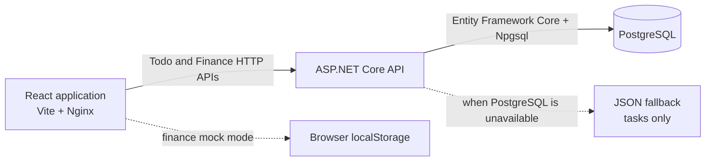

# Natural ToDo

> A full-stack task and personal finance planner built with React, ASP.NET Core, and PostgreSQL.

Natural ToDo brings everyday tasks and personal budgeting into one responsive workspace. The project explores a practical full-stack architecture: a Vite-built React client, a REST API in ASP.NET Core, relational persistence with PostgreSQL, and a Docker Compose setup for local development.

<p align="center">
  
  
  
  
</p>

## What it does

- **Task management:** create and update tasks, track completion and deadlines, and archive, restore, or permanently delete items.
- **Finance notebook:** record income and expenses, organize categories, set monthly budgets, and track savings goals and contributions.
- **At-a-glance summaries:** review spending by date and category, budget progress, and goal progress.
- **Resilient task storage:** when PostgreSQL is unavailable, the task API can use a JSON file store and reports fallback mode in the response headers.
- **Two finance data modes:** use the Finance API or browser-local mock storage for frontend development.

## Architecture



The frontend and backend remain separate applications. Docker Compose builds the frontend into static assets served by Nginx, runs the API as a separate service, and starts PostgreSQL with persistent named volumes.

### Stack

| Area | Technologies |
| --- | --- |
| Frontend | React 19, JavaScript, Vite, ESLint |
| Backend | ASP.NET Core 10, C#, Entity Framework Core, Npgsql |
| Database | PostgreSQL 15 |
| Runtime | Docker, Docker Compose, Nginx |
| CI | GitHub Actions: .NET restore/build and frontend lint/build |

## Run the full application

**Requirements:** Docker Desktop or Docker Engine with Docker Compose.

```bash
git clone <repository-url>
cd Natural-ToDo-App
docker compose up --build
```

Then open:

- Frontend: <http://localhost:5173>
- API health: <http://localhost:5186/health>
- Tasks API: <http://localhost:5186/api/todo>
- Finance API: <http://localhost:5186/api/finance>

Compose uses development defaults suitable for a local machine. To customize them, copy `.env.example` to `.env` and keep `DB_USER`, `DB_PASSWORD`, `DB_NAME`, and `DB_CONNECTION_STRING` consistent. Do not use the sample credentials outside local development.

Stop the services with `docker compose down`. Data remains in named volumes. `docker compose down -v` also removes the database and fallback volumes.

## Run for development

Start PostgreSQL first, then configure the backend connection string with `ConnectionStrings__DefaultConnection`. From the repository root, start the API:

```bash
dotnet run --project backend/Backend.csproj
```

In a second terminal, start the frontend:

```bash
cd frontend
npm ci
npm run dev
```

The local HTTP profile uses `http://localhost:5186`, and Vite uses `http://localhost:5173`. Set frontend options in `frontend/.env.local` when needed:

```env
VITE_API_URL=http://localhost:5186/api/todo
VITE_FINANCE_DATA_MODE=mock
VITE_FINANCE_API_URL=http://localhost:5186/api/finance
```

`VITE_FINANCE_DATA_MODE` accepts `mock` or `api`. In mock mode, finance data is stored in the current browser's `localStorage`. `VITE_*` variables are embedded in the client bundle; they must not contain secrets.

## API overview

The task API is rooted at `/api/todo` and supports create, list, update, soft delete, archive listing, restore, and hard delete.

The finance API is rooted at `/api/finance` and supports overview queries, categories, operations, monthly budgets and templates, savings goals, and goal contributions. In Development, the exact HTTP contract is available through Swagger at <http://localhost:5186/swagger>.

## Engineering notes

- **Persistence:** PostgreSQL is the primary store. Task endpoints can fall back to JSON files; Finance API endpoints require PostgreSQL. Browser finance mock data is separate from both backend stores.
- **Database setup:** the current startup path uses EF Core `EnsureCreated` plus the bundled SQL schema for finance tables. It also applies a compatibility check for the task table. This makes local setup convenient; a production deployment should use versioned migrations and an explicit deployment workflow.
- **Security boundary:** authentication and per-user data isolation are not implemented. The app is intended for local demonstration and development; it should not be exposed publicly with real personal or financial data as-is.
- **External services:** task and finance data stay within the app's configured storage. The interface's nature-fact card may request an external source and has a local fallback.

These are useful areas to discuss in a technical review: designing migration strategy, adding authentication and authorization, moving secrets to managed configuration, and introducing automated API and integration tests.

## Validation

The repository's local build checks are:

```bash
dotnet build Backend.sln --configuration Release
cd frontend
npm ci
npm run lint
npm run build
```

The Docker environment can be checked with:

```bash
docker compose config --quiet
docker compose up --build
```

## Project documentation

- [Backend architecture, API, and persistence](backend/README.md)
- [Frontend structure, configuration, and build](frontend/README.md)

## License

See [LICENSE](LICENSE).
